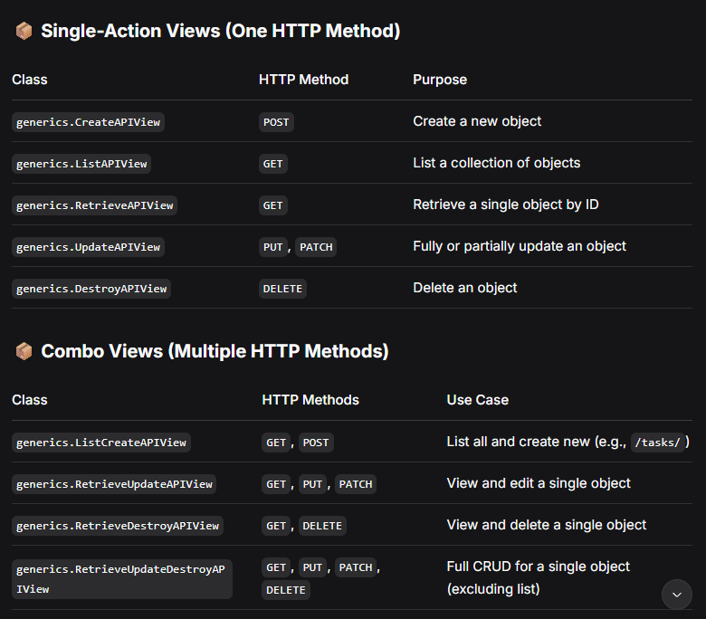

# ALL THE POSSIBLE END POINTS

## USERS RELATED END POINTS

- [x] Register Candidate : **/authentication/register/candidate/** POST
- [x] Register HR : **/authentication/register/hr/** POST
- [x] Login : **/auth/jwt/create/** POST
- [x] Refresh token : **/auth/jwt/refresh/** POST
- [x] Get Self Profile : **/auth/users/me/** GET
- [x] Update Self Profile : **/auth/users/me/** PATCH
- [x] Delete self : **authentication/candidate/delete-me/** DELETE
- [x] List All Users (HR) **authentication/hr/users** GET
- [x] Update Any User (HR) **authentication/hr/update/\<uuid>** UPDATE PATCH
- [x] Delete Any User (HR) **authentication/hr/users/\<uuid>** DELETE

## HR RELATED END POINTS

### Macro is requirement Micro is skills

#### Job_data

- [x] Create Job : **jobs/create/** POST
- [x] Fetch all jobs : **jobs/** GET
- [x] Fetch specific job : **jobs/\<uuid>/** GET
- [x] Delete an open job (Soft Deletion) : **jobs/\<uuid>/delete** DELETE
- [x] Update Job Data : **jobs/\<uuid>/update/** PATCH/UPDATE
- [x] Fetch raw job description (for ai) : **jobs/\<uuid>/rawRequirement/** GET\

---

#### Job_skills

- [x] Create Job requirements Bulk : **skills/bulk/\<uuid:job_uuid>/create/** POST
- [x] Fetch all job_skills with job UUID : **skills/\<uuid:job_uuid>/** GET
- [x] Update specific job_skills with UUID : **skills/\<uuid:uuid>/update/** UPDATE PATCH
- [x] Delete a specific job_skill with UUID : **skills/\<uuid>/delete/** DELETE

---

#### Job_requirements

- [x] Create minimum_requirements BULK : **requirements/bulk/\<uuid:job_uuid>/create/** POST
- [x] Fetch all minimum_requirements with job uuid : **requirements/\<uuid:job_uuid>/** GET
- [x] Update minimum_requirements with job UUID: **requirements/\<uuid>/update/** UPDATE PATCH
- [x] Delete a specific minimum_requirements with uuid : **requirements/\<uuid>/delete/** DELETE

---

## Candidate related endpoints

### 1 resume to apply for all

#### Applications endpoints

- [x] Create application : **application/create** POST
- [x] Fetch All applications for user : **application/** GET
- [x] Fetch specified application for user **application/\<uuid>/** GET
- [x] Fetch All application for job (hr) : **aplication/hr/\<uuid:job_uuid>/** GET
- [x] Fetch Top 5 for job (hr): **application/hr/\<uuid:job_uuid>/Top** GET
- [x] Update Application : **application/\<uuid>/update/** UPDATE PATCH
- [x] Delete Application : **application/\<uuid>/delete** DELETE (soft deletion)

#### Candidate Skills endpoints

- [x] Create candidate skills bulk : **candidate_skills/\<uuid:user_uuid>/create/** POST
- [x] Fetch all candidate skills (AI) : **candidate_skills/\<uuid:user_uuid>/** GET

#### Candidate resumes endpoints

- [x] Create candidate resume : **candidate_resume/create** POST
- [x] Fetch all resumes : **candidate_resume/** GET
- [x] Fetch Candidate resume (any): **candidate_resume/\<uuid:user_uuid>/** GET
- [x] Delete Candidate resume : **candidate_resume/delete/** DELETE
- [x] Delete any candidate resume : **candidate_resume/\<uuid:user_uuid>/delete/** DELETE

## important VIEWS

